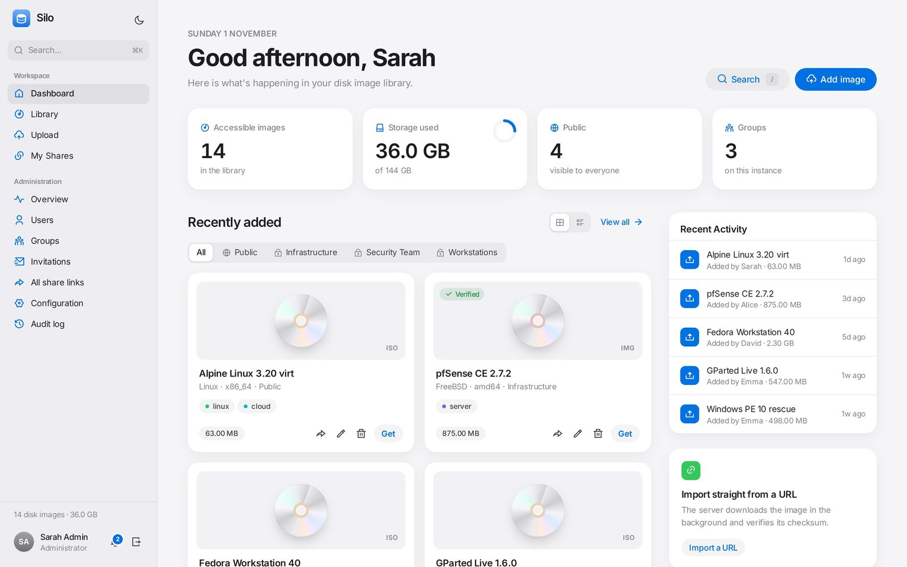
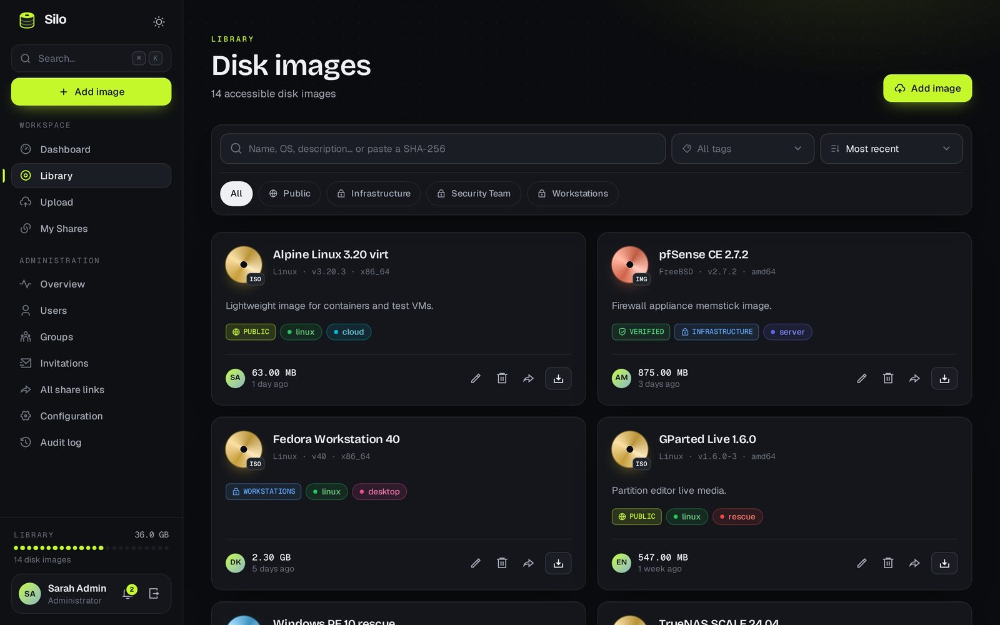
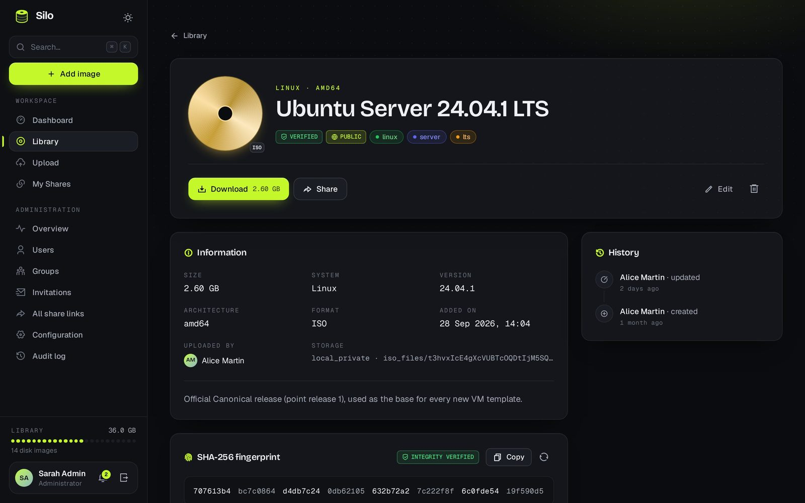
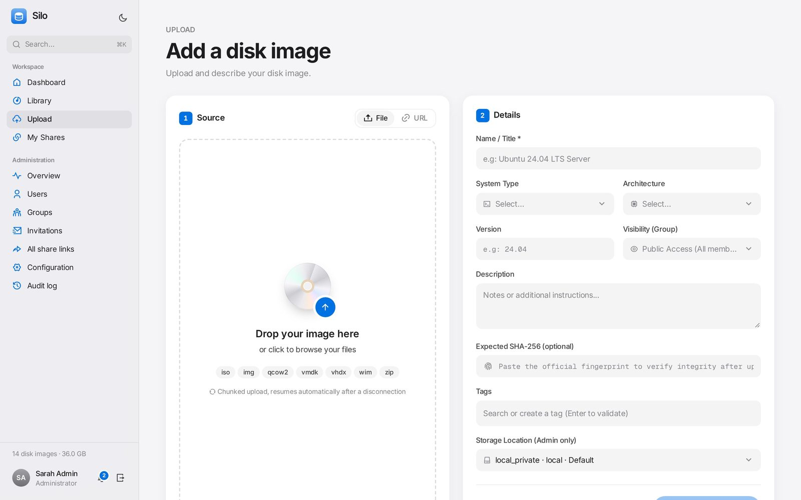
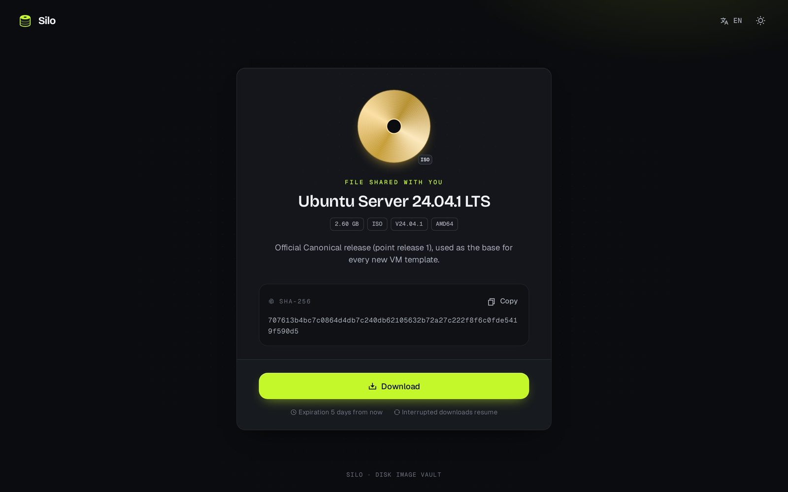
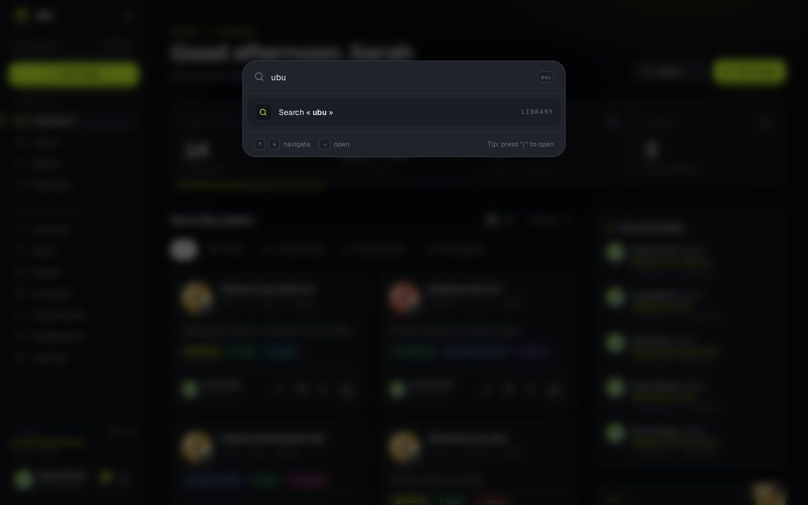
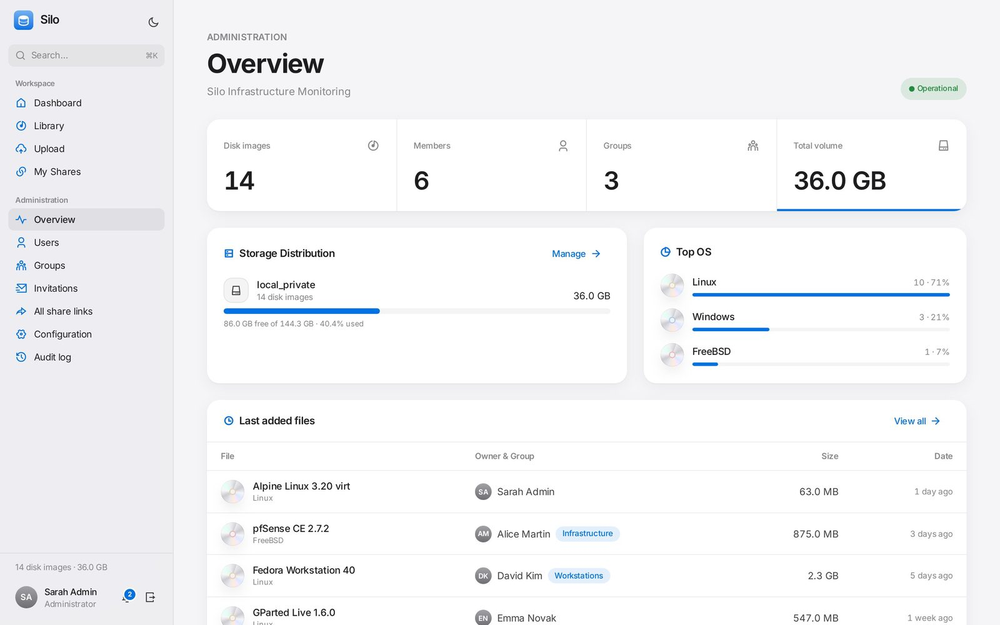
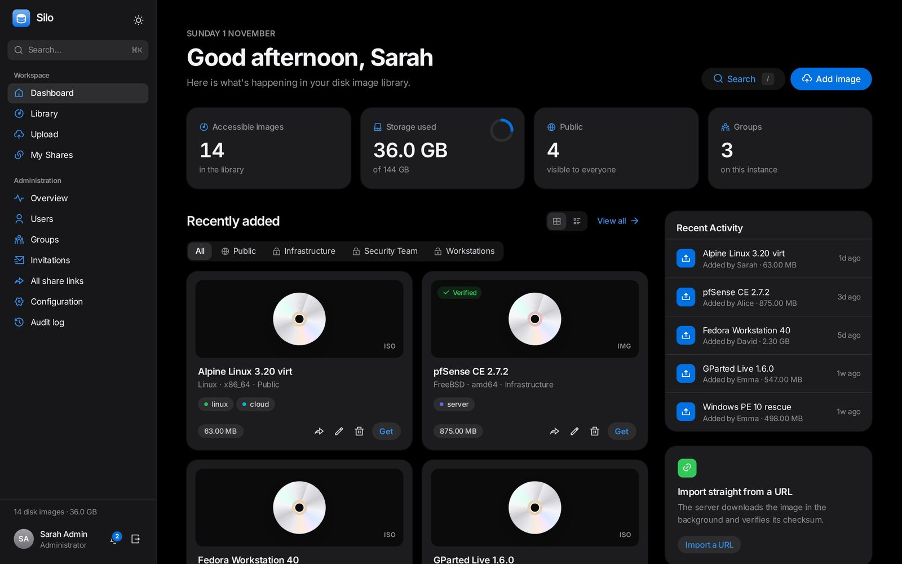
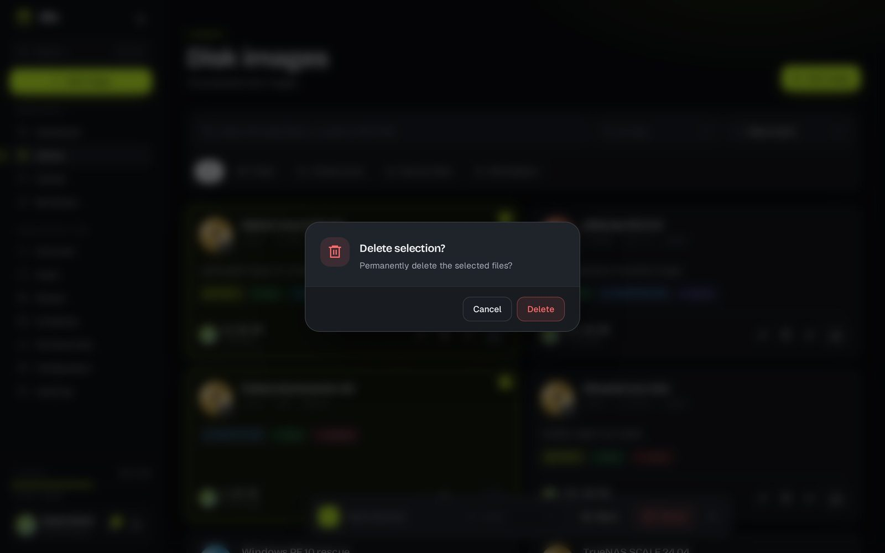
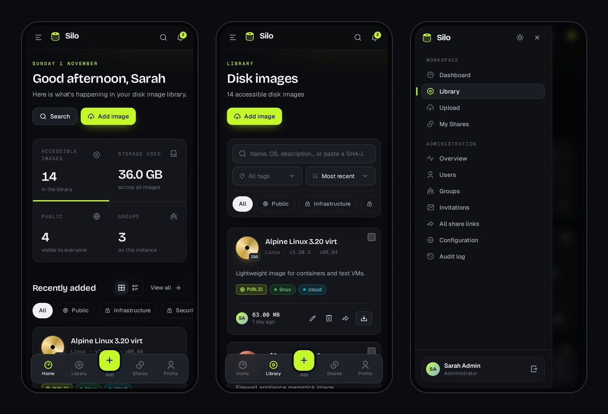

<div align="center">


# Silo

**Un coffre-fort auto-hébergé pour vos images disque — téléversez, organisez et partagez ISO, disques de VM et archives volumineuses.**

[](https://github.com/pokertour/Silo/actions/workflows/tests.yml)
[](https://github.com/pokertour/Silo/pkgs/container/silo)


[Fonctionnalités](#-fonctionnalités) · [Captures](#-captures-décran) · [Démarrage rapide](#-démarrage-rapide-docker) · [Configuration](#%EF%B8%8F-configuration) · [Sécurité](#-sécurité) · [Développement](#-développement)

🌐 [Site web](https://pokertour.github.io/Silo/) · 🇬🇧 [English version](README.md)

</div>

---

<p align="center"></p>

Silo est une application web pour les équipes qui ont besoin d'un endroit unique où stocker et distribuer leurs images disque : installeurs d'OS, modèles de VM, firmwares, supports de récupération… Elle gère sans difficulté les fichiers de plusieurs gigaoctets (upload par morceaux et reprise, téléchargements reprenables, checksums en arrière-plan), contrôle les accès par groupes et rôles, et permet de partager un fichier avec n'importe qui grâce à des liens protégés par mot de passe et à durée limitée.

**Formats pris en charge :** `iso` `img` `bin` `raw` `qcow2` `vhd` `vhdx` `vmdk` `wim` `esd` `zip` `7z` `tar` `gz` `xz`

## ✨ Fonctionnalités

### 📦 Gestion des fichiers
- **Upload par morceaux avec reprise** — glissez-déposez des fichiers de toute taille ; un upload interrompu reprend là où il s'était arrêté.
- **Import depuis une URL** — le serveur télécharge l'image en arrière-plan ; suivez la progression en direct (débit, temps restant), annulez ou relancez.
- **Intégrité SHA-256** — empreintes calculées en arrière-plan, comparées à la valeur attendue que vous fournissez, et recherchables (collez un hash pour retrouver le fichier).
- **Détection des doublons** — les fichiers identiques sont signalés automatiquement.
- **Métadonnées riches** — version, architecture, type d'OS, description et tags colorés, avec recherche, filtres, tri et actions groupées.
- **Téléchargements reprenables** — prise en charge des requêtes HTTP Range et gestionnaire de téléchargement intégré au navigateur avec suivi de progression.

### 🔗 Partage
- Liens publics avec **mot de passe**, **date d'expiration** et **limite de téléchargements** optionnels.
- Protection anti-bruteforce des mots de passe et notification du propriétaire à chaque téléchargement.
- Une page centrale pour consulter et révoquer tous les liens.

### 👥 Contrôle d'accès
- **Inscription sur invitation uniquement** (invitations à usage unique et à durée limitée, envoyées par email).
- **Groupes** : un fichier est soit visible par tous les utilisateurs, soit réservé aux membres d'un groupe.
- **Rôles** : les administrateurs gèrent tout, les utilisateurs gèrent leurs propres fichiers.
- **Authentification unique** OpenID Connect / OAuth 2 (Keycloak, Authentik, Entra ID, Google, Okta, GitLab, GitHub…) et **connexion LDAP / Active Directory**, avec création des comptes et rôle admin par groupe en option.
- **Double authentification** (TOTP) avec codes de récupération.

### 🛠️ Administration
- **Multi-stockage** : disque local, NFS, Amazon S3 (ou tout service compatible S3), FTP et SFTP — identifiants chiffrés en base.
- **Tableau de bord** : statistiques d'utilisation, capacité des stockages, répartition par OS.
- **Journal d'audit** de toutes les modifications, gestion des utilisateurs et des groupes, personnalisation (nom, logo, couleur).
- **4 langues** : anglais, français, espagnol, allemand — détectées depuis le navigateur.

### 🎨 Interface
- **Thèmes clair et sombre** qui suivent le système, couleur d'accent au choix et logo personnalisé.
- **Palette de commandes** (<kbd>⌘K</kbd>, <kbd>Ctrl K</kbd> ou <kbd>/</kbd>) pour chercher dans la bibliothèque et aller sur n'importe quelle page.
- **Interface mobile** avec barre d'onglets, menu latéral et dialogues en bas d'écran.
- Design épuré inspiré d'Apple : chaque image est présentée comme un produit, avec son propre CD argenté.

## 📸 Captures d'écran

| | |
|---|---|
|  |  |
| **Bibliothèque** — recherche, filtres, tags et actions groupées | **Détail** — SHA-256 vérifié, liens de partage, historique |
|  |  |
| **Upload** — morceaux reprenables ou import depuis une URL | **Page de partage** — ce que voient vos destinataires |
|  |  |
| **Palette de commandes** — <kbd>⌘K</kbd> / <kbd>/</kbd> pour aller partout | **Administration** — stockages, répartition par OS, activité |
|  |  |
| **Thème sombre** — suit le réglage du système | **Aucune popup du navigateur** — dialogues maison partout |

<p align="center"><br><sub>Une vraie interface mobile : barre d'onglets, menu latéral et dialogues en bas d'écran.</sub></p>

## 🚀 Démarrage rapide (Docker)

L'image embarque [FrankenPHP](https://frankenphp.dev), Redis, le worker de file d'attente et le planificateur. Il suffit de Docker et Docker Compose.

**1. Récupérez le fichier compose et le modèle d'environnement**

```bash
curl -O https://raw.githubusercontent.com/pokertour/Silo/main/docker-compose.yml
```

```bash
curl -o .env https://raw.githubusercontent.com/pokertour/Silo/main/.env.example
```

**2. Renseignez les secrets** dans `.env` :

| Variable | Valeur |
|---|---|
| `APP_KEY` | résultat de `echo "base64:$(openssl rand -base64 32)"` |
| `APP_URL` | URL publique de votre instance, ex. `https://silo.example.com` |
| `DB_PASSWORD` / `DB_ROOT_PASSWORD` | mots de passe aléatoires robustes (`openssl rand -base64 32`) |

**3. Démarrez la stack**

```bash
docker compose up -d
```

Les migrations s'exécutent automatiquement au démarrage. Silo écoute sur **http://localhost:8080** — placez-le derrière votre reverse proxy en HTTPS.

**4. Créez le compte administrateur**

```bash
docker compose exec app php artisan db:seed --force
```

Le seeder affiche un mot de passe généré aléatoirement (ou utilise `ADMIN_EMAIL` / `ADMIN_PASSWORD` s'ils sont définis). Connectez-vous, changez-le et activez la 2FA. Invitez ensuite vos utilisateurs depuis **Admin → Invitations**.

> [!TIP]
> Fixez une version plutôt que `latest` dans `docker-compose.yml` (ex. `ghcr.io/pokertour/silo:v1.0.0`) pour maîtriser les mises à jour.

## ⚙️ Configuration

L'image Docker embarque des valeurs par défaut de production (`APP_NAME=Silo`, `APP_ENV=production`, `LOG_CHANNEL=daily`, cache/sessions/files d'attente Redis, hôte MariaDB `db`…) : votre `.env` ne contient que les secrets ci-dessus. Toute variable reste surchargeable. Les plus utiles :

| Variable | Défaut | Description |
|---|---|---|
| `APP_URL` | — | URL publique, utilisée dans les liens de partage et les emails. |
| `APP_LOCALE` | `en` | Langue par défaut si celle du navigateur n'est pas prise en charge. |
| `TRUSTED_PROXIES` | réseaux privés | Reverse proxies autorisés à envoyer les en-têtes `X-Forwarded-*`. N'utilisez `*` que si Silo n'est joignable **que** via votre proxy. |
| `SESSION_SECURE_COOKIE` | `true` | À laisser activé en HTTPS. |
| `MAIL_MAILER`, `MAIL_HOST`, … | `log` | Paramètres SMTP de repli. Plus simple : configurez le SMTP depuis **Admin → Paramètres → E-mail** (mot de passe chiffré, bouton de test). |
| `ADMIN_EMAIL` / `ADMIN_PASSWORD` | mot de passe aléatoire | Administrateur initial créé par le seeder. |

Les emplacements de stockage (local, NFS, S3, FTP, SFTP) se gèrent depuis **Admin → Paramètres → Stockage**, pas via l'environnement. Les limites d'upload sont définies dans [`custom.ini`](custom.ini) (50 Go par défaut).

### Authentification unique et LDAP

Les deux se configurent dans **Admin → Paramètres → Authentification** ; les comptes locaux continuent de fonctionner.

- **OpenID Connect / OAuth 2** — saisissez l'URL de l'émetteur (les points de terminaison sont découverts via `/.well-known/openid-configuration`), le client ID et le secret, puis déclarez chez votre fournisseur l'URL de redirection affichée (`https://<votre-hôte>/auth/sso/callback`). Le flux utilise PKCE, `state` et `nonce`. Pour un fournisseur OAuth 2 simple comme GitHub, renseignez plutôt les URL d'autorisation, de jeton et userinfo.
- **LDAP / Active Directory** — serveur, chiffrement (STARTTLS ou LDAPS), base DN, compte de service optionnel et filtre utilisateur où `{login}` est remplacé par l'identifiant saisi.
- **Comptes** — par défaut, seuls les utilisateurs existants (même adresse e-mail) peuvent se connecter ; activez *Créer automatiquement les comptes* pour les créer à la première connexion. Un claim de groupe ou un groupe LDAP (`memberOf`) peut donner le rôle admin. La 2FA de Silo reste exigée pour les utilisateurs qui l'ont activée.

Les secrets (client secret, mot de passe du compte de service) sont chiffrés avec `APP_KEY`.

## 🔐 Sécurité

- **Gardez les images disque dans un stockage privé.** L'emplacement par défaut est `storage/app/private`. Ne faites jamais pointer un stockage vers `storage/app/public` : ce dossier est servi publiquement sous `/storage`, ce qui contournerait les droits d'accès et les liens de partage.
- **Servez Silo en HTTPS** et indiquez l'adresse de votre reverse proxy dans `TRUSTED_PROXIES` pour que les limitations de débit voient les vraies IP clientes.
- **Base de données** : le fichier compose n'expose pas MariaDB sur l'hôte et refuse de démarrer sans `DB_PASSWORD` / `DB_ROOT_PASSWORD`.
- **Sauvegardez `APP_KEY`** : elle chiffre les identifiants de stockage et les secrets 2FA. La changer les rend illisibles.

Vous avez trouvé une vulnérabilité ? Signalez-la en privé via les [GitHub Security Advisories](https://github.com/pokertour/Silo/security/advisories/new) plutôt que dans une issue publique.

## 💻 Développement

**Prérequis :** PHP 8.4+, Composer, Node.js 22+ et SQLite (ou MariaDB/MySQL/PostgreSQL).

```bash
git clone https://github.com/pokertour/Silo.git
```

```bash
cd Silo
```

```bash
composer run setup
```

`composer run setup` installe les dépendances, crée le `.env`, génère la clé, lance les migrations et compile les assets. Créez ensuite le compte admin et lancez tout (serveur web, worker, Vite) :

```bash
php artisan db:seed
```

```bash
composer run dev
```

**Tests et style de code**

```bash
php artisan test
```

```bash
./vendor/bin/pint
```

> [!NOTE]
> Les captures et le [site web](https://pokertour.github.io/Silo/) sont générés automatiquement par [`.github/workflows/pages.yml`](.github/workflows/pages.yml) : une instance de démo peuplée par `DemoSeeder` est démarrée, puis chaque écran est capturé avec Playwright (`scripts/screenshots.mjs`).

### Stack technique

| Couche | Technologie |
|---|---|
| Backend | [Laravel 13](https://laravel.com), [Fortify](https://github.com/laravel/fortify) (2FA) |
| Frontend | [Livewire 4](https://livewire.laravel.com) & [Volt](https://livewire.laravel.com/docs/volt), [Alpine.js](https://alpinejs.dev), [Tailwind CSS 4](https://tailwindcss.com), [Vite](https://vitejs.dev) |
| Uploads | [Resumable.js](https://github.com/23/resumable.js) |
| Permissions & audit | [spatie/laravel-permission](https://github.com/spatie/laravel-permission), [spatie/laravel-activitylog](https://github.com/spatie/laravel-activitylog) |
| Exécution | [FrankenPHP](https://frankenphp.dev), Redis, Supervisor |
| Tests | [Pest 4](https://pestphp.com) |

## 🚢 Publication

Les versions sont publiées sur GitHub Container Registry sous `ghcr.io/pokertour/silo:<version>` (et `:latest` pour les versions stables). Deux façons de publier :

**Depuis GitHub (recommandé) :** **Actions → Build and Push Docker Image → Run workflow**, saisissez la version (ex. `v1.2.0`) et lancez. Le workflow construit et publie l'image, puis crée le tag git et la release GitHub correspondants avec des notes générées automatiquement. Les pré-versions comme `v1.3.0-beta.1` ne sont jamais taguées `latest`.

**En ligne de commande :** poussez un tag `v*`.

```bash
git tag v1.0.0
```

```bash
git push origin v1.0.0
```

## 🤝 Contribuer

Les issues et pull requests sont les bienvenues. Lancez `php artisan test` et `./vendor/bin/pint` avant de soumettre — la CI vérifie les deux.
