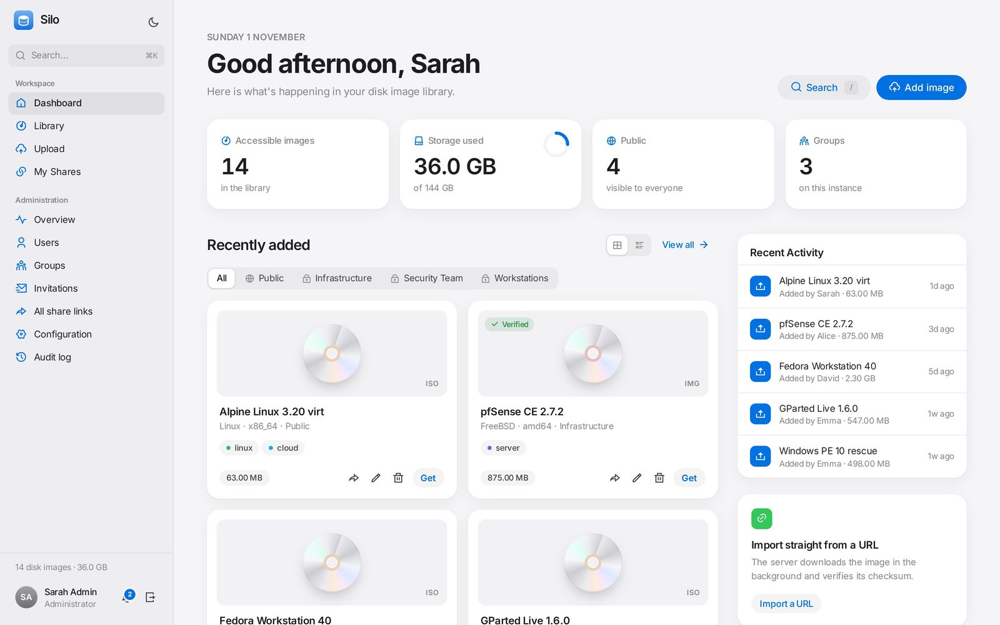
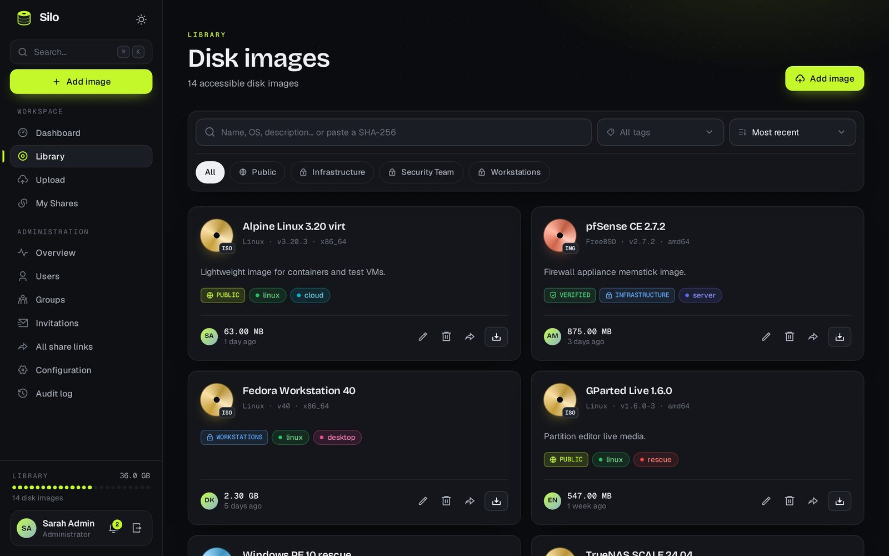
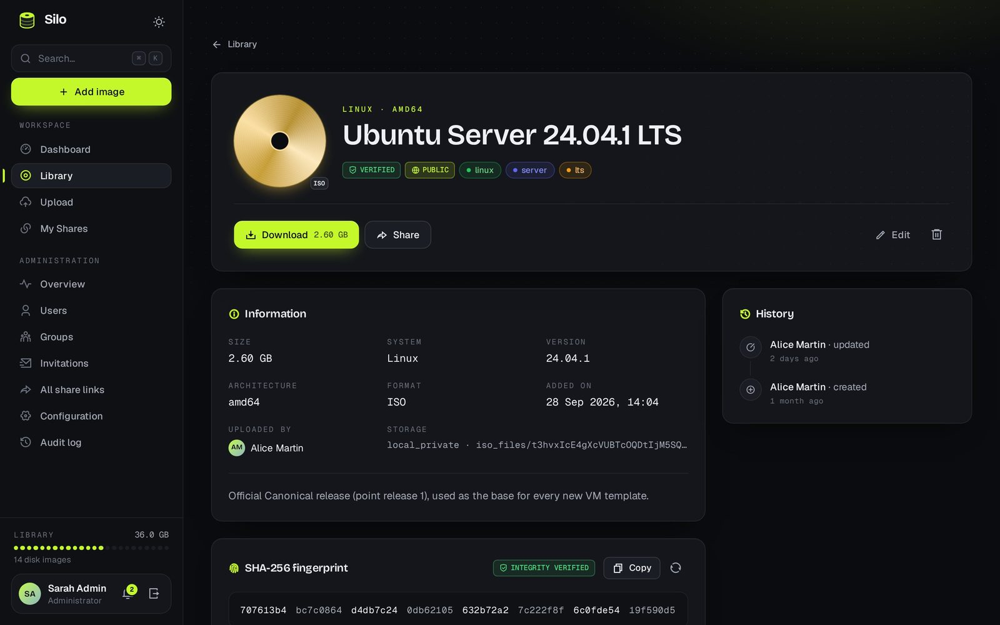
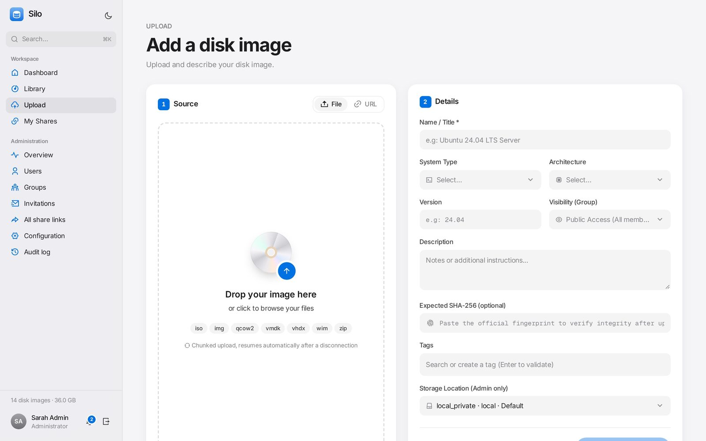
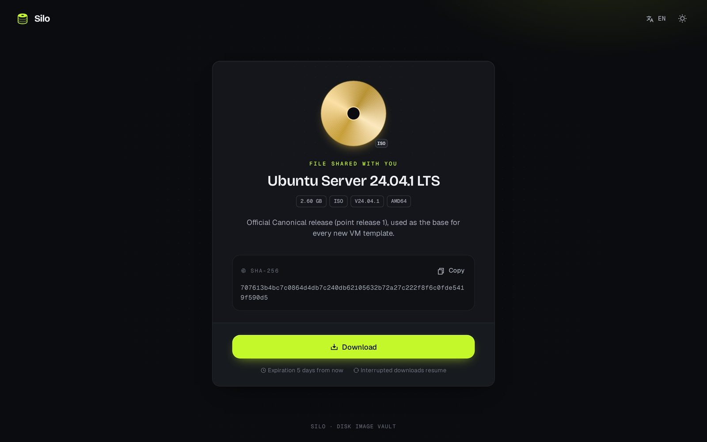
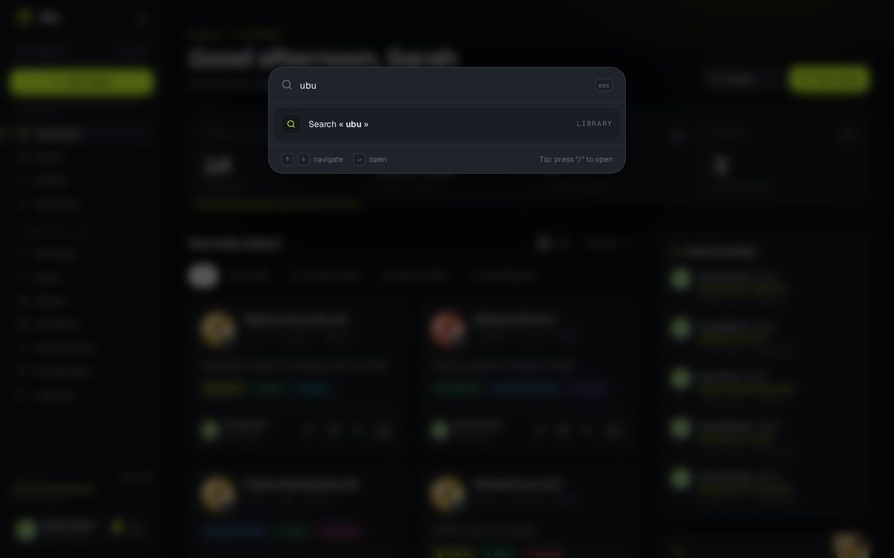
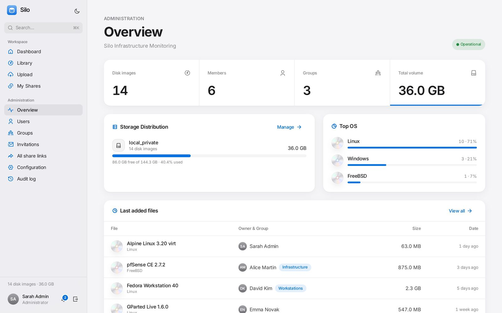
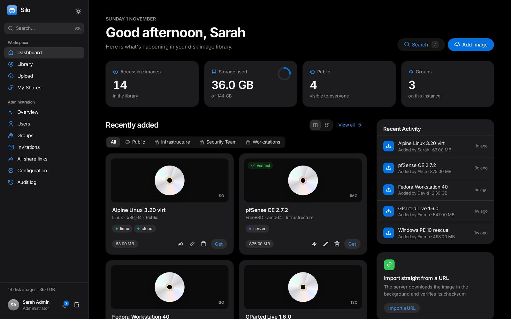
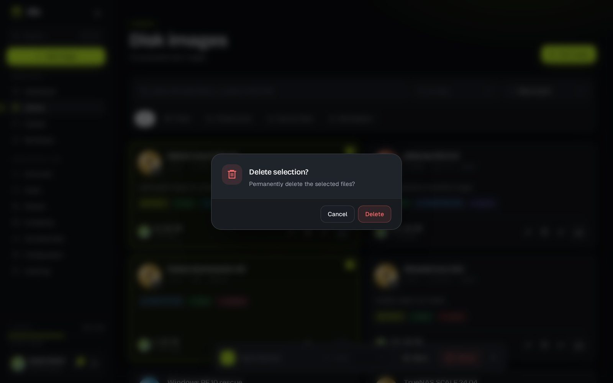
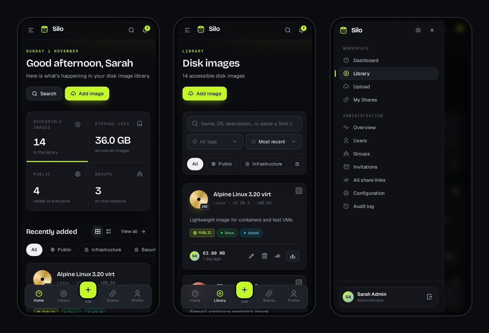

<div align="center">


# Silo

**A self-hosted vault for disk images — upload, organize and share ISOs, VM disks and large archives.**

[](https://github.com/pokertour/Silo/actions/workflows/tests.yml)
[](https://github.com/pokertour/Silo/pkgs/container/silo)


[Features](#-features) · [Screenshots](#-screenshots) · [Quick start](#-quick-start-docker) · [Configuration](#%EF%B8%8F-configuration) · [Security](#-security) · [Development](#-development)

🌐 [Website](https://pokertour.github.io/Silo/) · 🇫🇷 [Version française](README.fr.md)

</div>

---

<p align="center"></p>

Silo is a web application for teams that need one place to store and distribute their disk images: OS installers, VM templates, firmware, recovery media… It handles multi-gigabyte files gracefully (resumable chunked uploads, resumable downloads, background checksums), keeps access under control with groups and roles, and lets you share a file with anyone through expiring, password-protected links.

**Supported formats:** `iso` `img` `bin` `raw` `qcow2` `vhd` `vhdx` `vmdk` `wim` `esd` `zip` `7z` `tar` `gz` `xz`

## ✨ Features

### 📦 File management
- **Resumable chunked uploads** — drag & drop files of any size; interrupted uploads pick up where they left off.
- **Import from URL** — let the server download an image in the background, follow its progress live (speed, ETA), cancel or retry it.
- **SHA-256 integrity** — checksums are computed in the background, compared with the expected value you provide, and searchable (paste a hash to find the file).
- **Duplicate detection** — identical files are flagged automatically.
- **Rich metadata** — version, architecture, OS type, description and colored tags, with search, filters, sorting and bulk actions.
- **Resumable downloads** — HTTP Range support, plus an in-browser download manager with progress tracking.

### 🔗 Sharing
- Public share links with optional **password**, **expiration date** and **download limit**.
- Brute-force protection on link passwords and a notification to the owner on every download.
- A central page to review and revoke every link.

### 👥 Access control
- **Invitation-only registration** (single-use, expiring invitations sent by email).
- **Groups**: files are either visible to every user or restricted to a group's members.
- **Roles**: administrators manage everything; users manage their own files.
- **Two-factor authentication** (TOTP) with recovery codes.

### 🛠️ Administration
- **Multi-storage**: local disk, NFS, Amazon S3 (or any S3-compatible service), FTP and SFTP — credentials are encrypted at rest.
- **Dashboard** with usage statistics, storage capacity and OS distribution.
- **Audit log** of every change, user and group management, branding (name, logo, accent color).
- **4 languages**: English, French, Spanish, German — detected from the browser.

### 🎨 Interface
- **Light & dark themes** that follow your system, an accent color you choose and your own logo.
- **Command palette** (<kbd>⌘K</kbd>, <kbd>Ctrl K</kbd> or <kbd>/</kbd>) to search the library and jump to any page.
- **Mobile-first layout** with a tab bar, a slide-in menu and bottom-sheet dialogs.
- Clean, Apple-inspired design: every image is presented like a product, with its own silver disc.

## 📸 Screenshots

| | |
|---|---|
|  |  |
| **Library** — search, filters, tags and bulk actions | **Details** — verified SHA-256, share links, history |
|  |  |
| **Upload** — resumable chunks or import from URL | **Share page** — what your recipients see |
|  |  |
| **Command palette** — <kbd>⌘K</kbd> / <kbd>/</kbd> to jump anywhere | **Administration** — storage, OS distribution, activity |
|  |  |
| **Dark theme** — follows your system | **No browser popups** — custom dialogs everywhere |

<p align="center"><br><sub>A real mobile layout: tab bar, slide-in menu and bottom sheets.</sub></p>

## 🚀 Quick start (Docker)

The image bundles [FrankenPHP](https://frankenphp.dev), Redis, the queue worker and the scheduler. You only need Docker and Docker Compose.

**1. Get the compose file and the environment template**

```bash
curl -O https://raw.githubusercontent.com/pokertour/Silo/main/docker-compose.yml
```

```bash
curl -o .env https://raw.githubusercontent.com/pokertour/Silo/main/.env.example
```

**2. Fill in the secrets** in `.env`:

| Variable | Value |
|---|---|
| `APP_KEY` | output of `echo "base64:$(openssl rand -base64 32)"` |
| `APP_URL` | public URL of your instance, e.g. `https://silo.example.com` |
| `DB_PASSWORD` / `DB_ROOT_PASSWORD` | strong random passwords (`openssl rand -base64 32`) |

**3. Start the stack**

```bash
docker compose up -d
```

Migrations run automatically on startup. Silo listens on **http://localhost:8080** — put it behind your reverse proxy with HTTPS.

**4. Create the administrator account**

```bash
docker compose exec app php artisan db:seed --force
```

The seeder prints a randomly generated password (or uses `ADMIN_EMAIL` / `ADMIN_PASSWORD` if you set them). Log in, change it, and enable 2FA. Then invite your users from **Admin → Invitations**.

> [!TIP]
> Pin a version instead of `latest` in `docker-compose.yml` (e.g. `ghcr.io/pokertour/silo:v1.0.0`) to control upgrades.

## ⚙️ Configuration

The Docker image ships with production defaults (`APP_NAME=Silo`, `APP_ENV=production`, `LOG_CHANNEL=daily`, Redis cache/sessions/queue, MariaDB host `db`…), so your `.env` only needs the secrets above. Any variable can still be overridden. The most useful ones:

| Variable | Default | Description |
|---|---|---|
| `APP_URL` | — | Public URL, used in share links and emails. |
| `APP_LOCALE` | `en` | Default language when the browser preference is not supported. |
| `TRUSTED_PROXIES` | private networks | Reverse proxies allowed to send `X-Forwarded-*` headers. Use `*` only if Silo is reachable **exclusively** through your proxy. |
| `SESSION_SECURE_COOKIE` | `true` | Keep enabled when served over HTTPS. |
| `MAIL_MAILER`, `MAIL_HOST`, … | `log` | Fallback SMTP settings. Easier: configure SMTP from **Admin → Settings → Email** (password encrypted, test button). |
| `ADMIN_EMAIL` / `ADMIN_PASSWORD` | random password | Initial administrator created by the seeder. |

Storage locations (local, NFS, S3, FTP, SFTP) are managed from **Admin → Settings → Storage**, not from the environment. Upload limits are set in [`custom.ini`](custom.ini) (50 GB by default).

## 🔐 Security

- **Keep disk images in private storage.** The default location is `storage/app/private`. Never point a storage location at `storage/app/public`: that folder is publicly served under `/storage`, which would bypass permissions and share links.
- **Serve Silo over HTTPS** and set `TRUSTED_PROXIES` to your reverse proxy's address so rate limiting sees real client IPs.
- **Database**: the compose file does not expose MariaDB on the host and refuses to start without `DB_PASSWORD` / `DB_ROOT_PASSWORD`.
- **Back up `APP_KEY`**: it encrypts storage credentials and 2FA secrets. Changing it makes them unreadable.

Found a vulnerability? Please report it privately through [GitHub Security Advisories](https://github.com/pokertour/Silo/security/advisories/new) rather than opening a public issue.

## 💻 Development

**Requirements:** PHP 8.4+, Composer, Node.js 22+, and SQLite (or MariaDB/MySQL/PostgreSQL).

```bash
git clone https://github.com/pokertour/Silo.git
```

```bash
cd Silo
```

```bash
composer run setup
```

`composer run setup` installs dependencies, creates `.env`, generates the key, runs the migrations and builds the assets. Then seed the admin account and start everything (web server, queue worker, Vite):

```bash
php artisan db:seed
```

```bash
composer run dev
```

**Tests and code style**

```bash
php artisan test
```

```bash
./vendor/bin/pint
```

> [!NOTE]
> The screenshots and the [website](https://pokertour.github.io/Silo/) are generated automatically by [`.github/workflows/pages.yml`](.github/workflows/pages.yml): it boots a demo instance seeded by `DemoSeeder` and captures every screen with Playwright (`scripts/screenshots.mjs`).

### Tech stack

| Layer | Technology |
|---|---|
| Backend | [Laravel 13](https://laravel.com), [Fortify](https://github.com/laravel/fortify) (2FA) |
| Frontend | [Livewire 4](https://livewire.laravel.com) & [Volt](https://livewire.laravel.com/docs/volt), [Alpine.js](https://alpinejs.dev), [Tailwind CSS 4](https://tailwindcss.com), [Vite](https://vitejs.dev) |
| Uploads | [Resumable.js](https://github.com/23/resumable.js) |
| Permissions & audit | [spatie/laravel-permission](https://github.com/spatie/laravel-permission), [spatie/laravel-activitylog](https://github.com/spatie/laravel-activitylog) |
| Runtime | [FrankenPHP](https://frankenphp.dev), Redis, Supervisor |
| Tests | [Pest 4](https://pestphp.com) |

## 🚢 Releases

Releases are published to GitHub Container Registry as `ghcr.io/pokertour/silo:<version>` (and `:latest` for stable versions). Two ways to publish:

**From GitHub (recommended):** go to **Actions → Build and Push Docker Image → Run workflow**, enter the version (e.g. `v1.2.0`) and run. The workflow builds and pushes the image, then creates the matching git tag and GitHub release with auto-generated notes. Pre-releases such as `v1.3.0-beta.1` are never tagged `latest`.

**From the command line:** push a `v*` tag.

```bash
git tag v1.0.0
```

```bash
git push origin v1.0.0
```

## 🤝 Contributing

Issues and pull requests are welcome. Please run `php artisan test` and `./vendor/bin/pint` before submitting — CI checks both.
